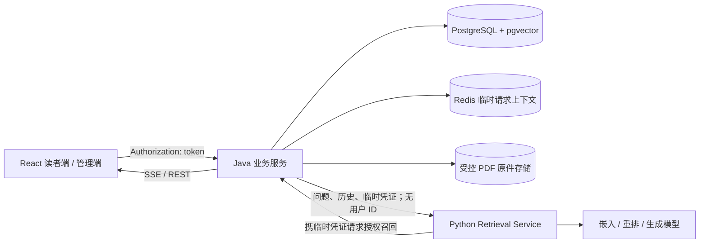

# GuguWiki 项目书（开发实施版）

> 版本：首版前端与服务契约。当前仓库已实现 React 前端和确定性 Mock，并提供 Nginx、PostgreSQL（含 pgvector）、Redis 的 Docker Compose 配置；Java 后端、Python Retrieval Service 及应用层数据库/Redis 接入待实现。本文描述目标架构，不把 Mock 结果当作线上验证。

## 1. 项目目标与边界

GuguWiki 面向需要共享技术资料的组织。管理员导入或编辑文档，索引成功后发布；读者浏览已发布的 Wiki、关键词搜索，或通过带出处的流式回答查找信息。证据不足时系统明确弃答。

首版只保留读者和管理员两个角色：读者可以访问所有已发布内容，管理员可以管理全部内容和账号。系统不提供用户组或知识库/文档级访问范围配置。首版还包含 Markdown/PDF 导入、草稿与发布版本、PostgreSQL FTS + pgvector 混合检索、多会话问答、检索实验室和审计契约；不建设个人记忆、匿名公开站点、扫描 PDF OCR 或第三方内容源导入。

前端入口选择不授予角色。管理员创建读者或管理员账号；登录成功后 Java 返回随机 token，前端后续请求通过 `Authorization` 请求头携带 token，Java 在 Redis 中校验登录状态并判定角色与会话归属。Mock 账号仅用于演示。

## 2. 系统职责与数据流



| 组件 | 责任 |
| --- | --- |
| React | Wiki、问答、文档管理、权限管理、单次调试、离线评测；使用统一 DTO 与请求层。 |
| Java | 登录和 Redis token 会话、角色校验、会话归属、原件存储、业务写入、发布版本切换、已发布内容检索、审计、对外 SSE。 |
| Python Retrieval Service | PDF 文字提取、文档切片及向量生成；查询处理、并行召回编排、RRF、可选重排、证据充分性判断与回答生成。 |
| PostgreSQL | 用户与角色、知识库、文档和不可变版本、切片及 `tsvector`/`vector`、会话消息、评测快照/结果、审计。 |
| Redis | 登录 token、短期请求凭证与运行态缓存；不作为会话消息或实验结果的唯一持久来源。 |

Java 向 Python 传递随机、短期、单次请求凭证。凭证在 Java/Redis 中关联请求上下文，但 Python 不接收 Cookie、用户 ID 或角色。Python 可看到授权检索返回的文档片段和引用，因生成有依据的回答需要这些材料。Java 在每次内部召回调用时重新检查当前权限，不依赖签发凭证时缓存的权限快照。

## 3. 内容、版本与角色访问规则

### 内容模型

所有登录读者均可访问全部已发布知识库和文档；管理员还可查看草稿、导入、编辑和发布内容。目录只负责组织结构，不单独授权。Markdown 正文可在线编辑；PDF 原件由 Java 管理的受控目录保存，PostgreSQL 保存元数据、提取文字、切片与索引。下载原件时仍需检查登录状态和发布状态。

核心表包括：`users`、`knowledge_bases`、`folders`、`documents`、`document_versions`、`document_chunks`、`import_jobs`、`publish_jobs`、`conversations`、`messages`、`message_evidence`、`chat_runs`、`evaluation_datasets`、`evaluation_snapshots`、`evaluation_runs`、`retrieval_strategies`、`audit_events`。`folders.parent_id` 与 `documents.parent_id` 组成知识库目录树，写入时验证父目录属于同一知识库；`documents.active_version_id` 指向唯一当前生效版本；版本和切片保留不可变记录。旧版数据库中的用户组关联表不再参与应用授权。

### 导入与发布

1. Java 接收 Markdown/PDF。PDF 原件存储后，Python 提取文字；扫描件或空文本返回解析失败。导入成功只创建草稿。
2. 管理员保存草稿时提交 `expectedRevision`。版本不一致返回 `409 CONFLICT`。
3. 发布时同文档只允许一个进行中的任务。Python 根据本次草稿快照切片并生成向量；Java验证任务、草稿修订号及当前权限状态后，在数据库事务中写入完整新版本及切片并切换 `active_version_id`。写入或索引失败保留旧指针。
4. 首次发布未成功的文档对读者不可见。已有发布版本在新任务处理中仍可被 Wiki 和检索读取；下架或切换生效版本后，读者请求立即按新的 `active_version_id` 处理。

### 权限与撤权

Java 在文档列表、详情、PDF 原件、两路检索候选、引用打开和历史记录读取时校验登录身份、角色、会话归属及文档发布状态。读者检索候选集合先限定已发布版本，再排序及 `LIMIT`；固定 Top-K 之后过滤发布状态会遗漏可读文档，也不能作为安全边界。示意：

```sql
WITH allowed_documents AS (
  SELECT d.id, d.active_version_id
  FROM documents d
  WHERE d.active_version_id IS NOT NULL
), ranked AS (
  SELECT c.id, c.document_id, c.version_id, c.content,
         ts_rank(c.search_vector, plainto_tsquery('simple', :segmented_query)) AS score
  FROM document_chunks c
  JOIN allowed_documents d
    ON d.id = c.document_id AND d.active_version_id = c.version_id
  WHERE c.search_vector @@ plainto_tsquery('simple', :segmented_query)
)
SELECT id, document_id, version_id, content, score
FROM ranked
ORDER BY score DESC, id
LIMIT :fts_top_k;
```

上段示意发布状态与 `LIMIT` 的先后位置。中文语料由 Python 在索引与查询两侧采用同版本的分词规则，Java 将分词后的安全参数交给 PostgreSQL FTS；语言配置、索引和实际查询计划需按语料验证。向量查询使用同一个 `allowed_documents` 关系，再按距离排序和 `LIMIT`。首版优先在已发布候选集合内做精确向量排序；若日后引入近似索引，必须验证其过滤及召回行为，不能以取全局近邻后过滤替代发布状态过滤。

回答消息保存引用文档 ID 与版本 ID。用户失去某引用文档权限后，历史提问与审计仍保留，但受影响的回答正文和引用不再返回前端，也不得进入后续 Agent 上下文。读取已保存评测结果同样重新授权并隐藏已撤权内容。

## 4. 检索与回答策略

Python 对问题做必要的查询处理，并行调用 Java 的授权 FTS 和向量召回原语。每一路有独立 Top-K 与原始分数阈值；FTS 排名分、向量相似度和重排分属于不同尺度，不能共用阈值。通过各路阈值的候选使用可配置权重与 `1/(rrfK + rank)` 做 RRF 融合，再按配置重排、选取最终证据。

证据充分性由**各路独立阈值、最少有效证据数，以及可选的问题事实覆盖判断**共同控制。单路失败时，必须确认另一条链路及权限检查成功，并对剩余证据执行同样的质量门槛；可在实验室调高降级门槛。权限失败一律拒绝。两路无足够证据时，Java/Python 返回固定的“知识库中没有足够的信息”，不调用生成模型补全内部文档事实。回答生成只允许依据授权证据，并返回文档版本引用。

正式策略从评测实验中人工启用，保存策略版本及操作者审计记录。在线检索始终基于当前 `active_version_id` 与当前权限，不读取实验快照作为授权依据。

## 5. 检索实验室

**单次 Query 调试**：管理员输入问题和参数，查看全部已发布文档的 FTS/向量候选、各自原始分数、RRF 融合、重排、证据充分性、降级状态及阶段耗时。

**离线评测**：管理员选取文档级 0–3 相关性标注数据集。启动时冻结全部已发布文档版本、切片/索引和语料指纹、数据集及标注指纹、检索配置与模型版本。不同配置可基于同一语料快照运行；每次运行不可变地保存自己的参数、排名结果、Recall@K、MRR、nDCG、P50/P95 耗时。

实验执行前和运行中都核验当前权限。若当前授权与冻结视图冲突，任务转为 `INVALIDATED`，不继续按旧视图读取内容。已保存结果再次读取时重新授权，必要时隐藏排名明细。这样实验条件可追溯，同时快照不能绕过在线权限。更换语料或标注后需建立新快照。

## 6. 流式问答与取消

会话和消息由 Java 持久化到 PostgreSQL；Redis 只保存请求临时态。Java 创建 `chat_run` 与用户/助手消息后调用 Python，向前端输出含事件 ID、会话 ID、消息 ID 的 SSE。引用先于或伴随文本增量发送；终态为 `COMPLETED` 或 `FAILED`。

取消采用协作式状态机：`RUNNING → CANCEL_REQUESTED → CANCELLED`。前端请求取消后仅显示“取消中”；Java 持久化中间状态，通知 Python 并关闭流；Python尽力停止后续检索或生成；Java保存已生成文本并确认 `CANCELLED`。如果完成先于取消，则保持 `COMPLETED`。部分模型调用无法立刻停止，前端通过任务状态接口确认终态，不能以断流等同取消成功。SSE `eventId` 用于去重；断线后通过持久消息和运行状态恢复，而非依赖事件流重放。

## 7. 实施顺序与验收

1. 前端共享 DTO、请求接口、HTTP/Mock 适配器及登录与读者页面。
2. 管理端账号角色、内容/版本状态与检索实验室；固定演示数据、故障切换、重置。
3. Java 实现身份、权限、业务表、FTS/pgvector 授权原语、版本事务和 SSE；Python 实现索引处理与 Retrieval Service。
4. 按接口文档做联调、权限审计与离线评测复现。

验收覆盖：权限条件在两路候选查询及 Top-K 之前；权限失败不可降级；FTS/向量分别故障时满足证据条件才继续；证据不足弃答；发布失败及并发冲突保留旧版；撤权影响实时结果、引用与历史；相同快照可比较不同策略；取消保留部分回答且经过 `CANCEL_REQUESTED`。当前仓库完成前端 Mock 层、自动测试与 Nginx/PostgreSQL/Redis 容器配置；尚不宣称 Java/Python 服务或数据库业务链路端到端通过。

## 8. 本地部署配置

React 项目位于 `frontend/`。根目录 `compose.yaml` 构建前端并由 Nginx 提供静态页面，使用 PostgreSQL 16 + pgvector 和 Redis 7 的持久数据卷。`infra/postgres/001_extensions.sql` 在新数据库首次初始化时启用 `vector` 扩展。根目录 `.env` 是本地唯一配置入口，集中保存前端地址、Java API 上游、数据库和 Redis 的本机/容器内地址与凭据；真实密码不进入前端构建产物。Nginx 将 `/api/` 转发至 Java，并关闭代理缓冲支持 SSE。启动与联调命令见 `README.md`。
